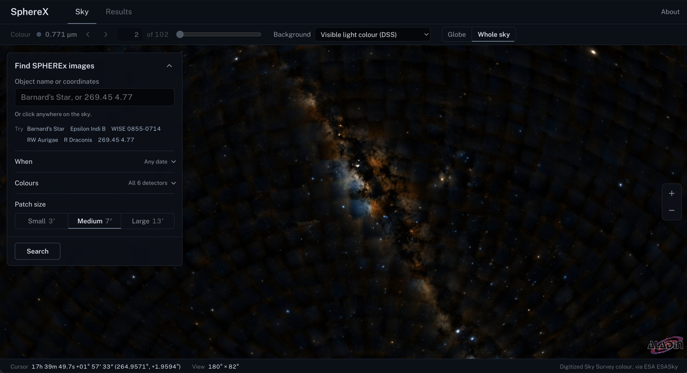
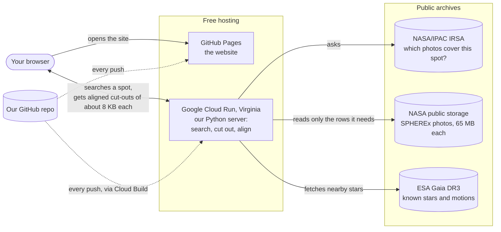
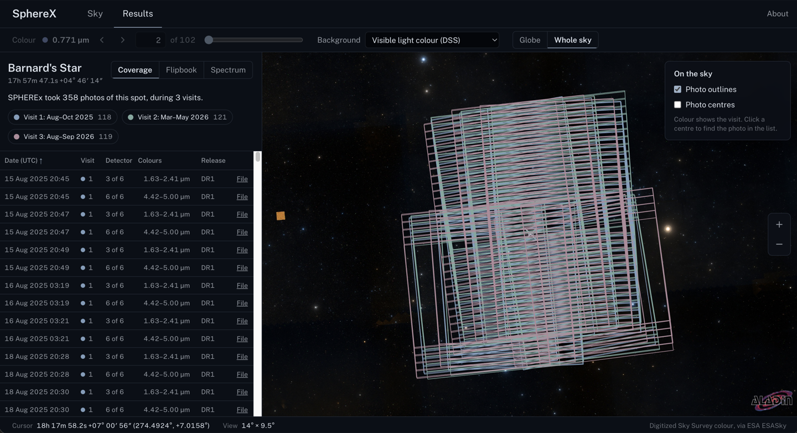
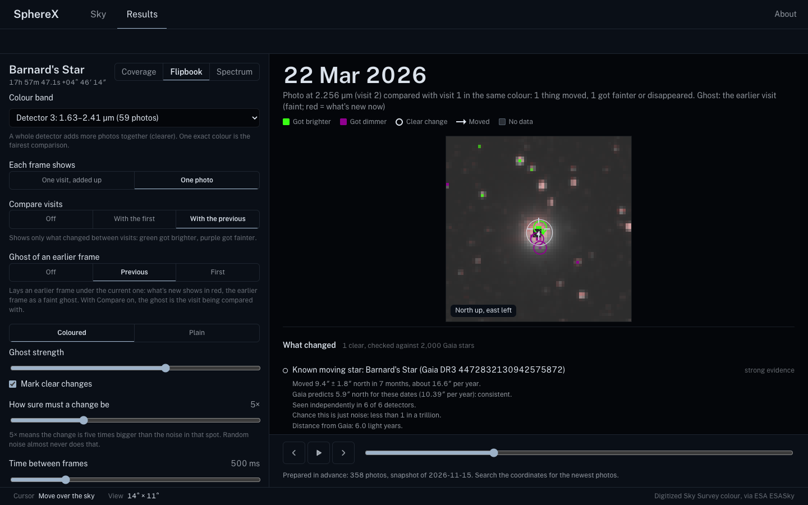
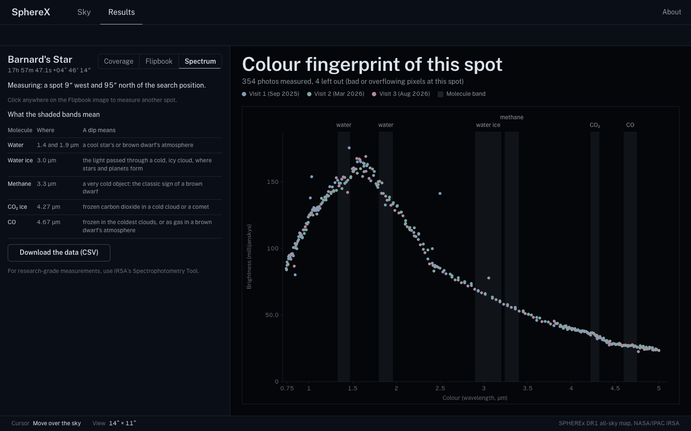

# SphereX

This solution was developed as part of NASA Space Apps Tel Aviv 2026. The event was led by the Space Engineering
Center (SEC) and SpaceTAU at Tel Aviv University, in partnership with the Rakia Mission and Space Campus IL.

**Watch the infrared sky change.**  https://flashyflash3011.github.io/SphereX/

## Why we built it

NASA's SPHEREx telescope maps the whole sky every six months in 102 colours of infrared light. Put two of those
maps side by side and things start to move: nearby stars, cold brown dwarfs, asteroids, stars that flicker.
That is how Pluto was found, and how volunteers found most known brown dwarfs.

The data is public, but the official tools are built for experts and can't play the photos over time. We wanted
anyone to be able to pick a spot in the sky and simply watch it change.

## What you can do

- **Search the sky**: by name, by coordinates, or by clicking the SPHEREx all-sky map.
- **See every photo**: SPHEREx took of that spot, on the sky and in a list.
- **Play the flipbook**: the photos lined up and played over time, one photo or one visit per frame.
- **Spot the changes**: easy to read, accessible to the user, and clearly visible, with a color legend explaining the different changes, along side a ghosting feature(outlining clearly the 'ghost' of the previous frame).
- **Understand the changes**: every change gets a plain-words verdict, checked against ESA's Gaia star catalogue, like
  *"Known moving star: Barnard's Star"* or *"Unknown mover: candidate"*.
- **Read a star's fingerprint**: its brightness across SPHEREx's colours, with water, methane, CO₂ and CO marked.

## How it works

A small Python server does the heavy lifting. It asks NASA's IRSA archive which SPHEREx photos cover the spot,
then reads only the few rows it needs from each 65 MB file in NASA's public storage. Each cut-out is cleaned,
turned north-up onto a common grid and labelled with the exact colour it saw, then streamed to the browser.

The browser does the rest instantly: it plays the frames on the GPU, compares visits, and explains what changed.
Comparisons are kept honest by only comparing photos taken in the same colours, measuring the noise in every
pixel, and leaving out anything too close to that noise or to a very bright star. Each verdict combines a few
simple statistical tests with Gaia's known positions and motions, with no AI involved.

Built with Python, FastAPI, Astropy, plain JavaScript, WebGL2 and Aladin Lite, running on GitHub Pages and
Google Cloud Run.

## Results

For example, on Barnard's Star, the fastest-moving star in our sky, SphereX finds 358 photos from 3 visits and flags it as a
known moving star, with a measured motion that agrees with Gaia's. An ordinary patch of sky comes back clean.

**Every photo of the spot**: 358 SPHEREx photos of Barnard's Star, outlined on the sky and listed by date.

**What changed**: a photo from March 2026 compared with the previous visit, with a ghost of the earlier frame.
Barnard's Star has moved north, and SphereX explains it: 9.4″ ± 1.8″ measured, 5.9″ predicted by Gaia for these
dates, consistent, seen in 6 of 6 detectors.

**The colour fingerprint**: one star measured in 354 photos across SPHEREx's colours. All three visits overlap,
so its brightness didn't change.

## Credits

SPHEREx DR1 and QR3 images and the DR1 all-sky map (DOIs 10.26131/IRSA678, IRSA662, IRSA679) come from the
NASA/IPAC Infrared Science Archive. *This publication makes use of data products from the Spectro-Photometer for
the History of the Universe, Epoch of Reionization and Ices Explorer (SPHEREx), which is a joint project of the
Jet Propulsion Laboratory and the California Institute of Technology, and is funded by the National Aeronautics
and Space Administration.*

Gaia DR3 comes from ESA via VizieR. *This work has made use of data from the European Space Agency (ESA) mission
Gaia (https://www.cosmos.esa.int/gaia), processed by the Gaia Data Processing and Analysis Consortium (DPAC).
Funding for the DPAC has been provided by national institutions, in particular the institutions participating in
the Gaia Multilateral Agreement.*

Also used: 2MASS and DSS colour maps, the Sesame name resolver (CDS), Aladin Lite 3.8.2 (CDS, LGPL-3.0),
Astropy, NumPy, SciPy, FastAPI, Uvicorn, certifi and the Public Sans typeface. Inspired by WiseView, Backyard
Worlds and IRSA's SPHEREx Data Explorer.

Licensed under Apache 2.0 (see [LICENSE](LICENSE)).
